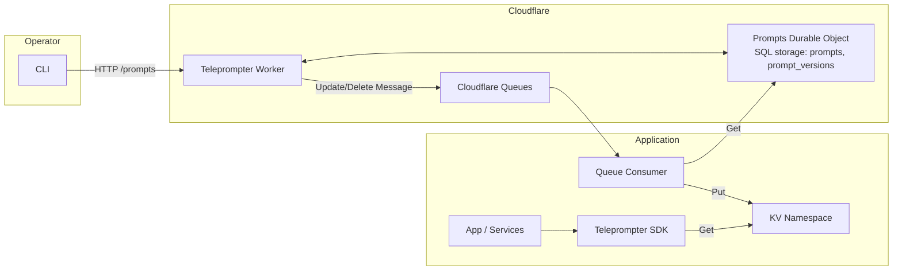
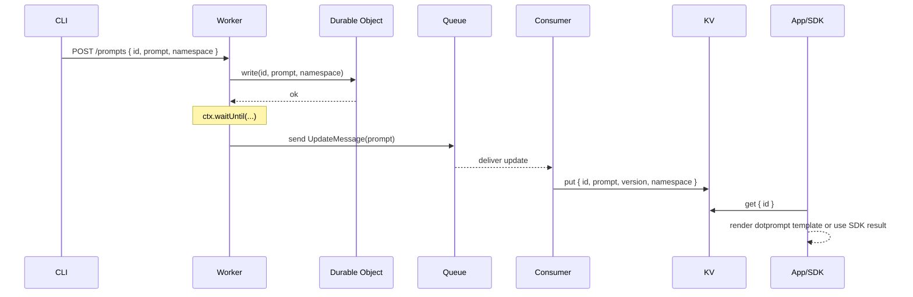

# Teleprompter Theory of Operation

## Overview
 Teleprompter manages runtime prompts for LLM applications on Cloudflare. A Cloudflare Worker exposes a small HTTP API backed by a Durable Object for storage. Operators update prompts with a CLI. When a prompt changes, the Worker publishes an update to a Cloudflare Queue identified by the prompt’s namespace. Your application consumes the update, caches the prompt in KV, and serves it via the SDK or renders it directly. Prompts use the [dotprompt](https://github.com/google/dotprompt) format as the primary prompt format. Each prompt stores the full original dotprompt source plus parsed metadata extracted from YAML frontmatter. Plain templates without frontmatter remain valid only as a compatibility path. Prompts are append only with rollback support.

## Major Components
- Teleprompter Worker
  - Cloudflare Worker exposing REST endpoints under /prompts
  - Validates dotprompt frontmatter before writes and returns a 400 error payload when validation fails
  - Orchestrates writes, rollbacks, deletions, and update distribution
- Prompts Durable Object
  - Durable Object that stores current prompts and a full version history using SQL storage
  - Persists the full raw dotprompt source in `prompt` and the parsed YAML frontmatter object in `metadata`
  - Single instance keyed by name (idFromName("teleprompter")) for consistent state
- Cloudflare Queues
  - One or more Queue bindings in the Worker environment
  - The Prompt.namespace field must match a Queue binding key in Env
  - Update and delete messages are dispatched for downstream consumers
- CLI Tool
  - Issues HTTP calls to the Worker to list, create, update, rollback, and delete prompts
- SDK
  - TypeScript SDK used by applications to fetch prompts and construct update/delete messages
- Application Consumer
  - Queue consumer that receives updates and writes them to application KV for low-latency reads

## Architecture


## Data Model
- Prompt
  - id: string
  - prompt: string (the full original prompt source, including any dotprompt frontmatter and body)
  - namespace: string
  - version: number
  - metadata: object (the parsed YAML frontmatter object)
    - `model`: model identifier
    - `config`: model configuration values
    - `input.default`: default input values
    - `input.schema`: input schema definition
    - `output.format`: output format
    - `output.schema`: output schema definition
    - `tools`: tool names
    - `description`: prompt description
    - `ext`: extension specific metadata
- Versioning
  - version is a UNIX timestamp in milliseconds
  - Writes upsert the current row in `prompts` and append a new row to `prompt_versions`
  - Teleprompter persists `metadata` in both `prompts` and `prompt_versions`
  - Each historical version keeps its own metadata snapshot alongside its stored prompt source
  - Delete removes the current row and appends a sentinel version marked as deleted
- Templates
  - Prompt text uses dotprompt when frontmatter begins at the start of the prompt source
  - Empty frontmatter is valid and produces `metadata: {}`
  - Plain templates without frontmatter remain valid for backward compatibility and Teleprompter stores them with `metadata: {}`
  - Frontmatter with CRLF line endings is valid
  - Malformed YAML frontmatter is rejected at write time
  - Frontmatter that parses to anything other than a YAML object is rejected at write time

## Request Routing
- GET /prompts
  - Return all prompts
- GET /prompts/:id
  - Return a single prompt
- GET /prompts/:id/versions
  - Return all versions for a prompt in descending version order
- POST /prompts
  - Body: { id, prompt, namespace }
  - Validate dotprompt frontmatter before writing
  - Return HTTP 400 with an error payload when validation fails
  - Create a new version for a prompt and dispatch an update message
- POST /prompts/:id/versions/:version
  - Roll back a prompt to a historical version and dispatch an update message
- DELETE /prompts/:id
  - Delete a prompt and dispatch a delete message

## Prompt Update And Distribution


Queue consumers receive prompts whose `prompt` field still contains the full stored dotprompt source. The parsed frontmatter metadata remains available separately on the prompt record.

- Rollback
  - POST /prompts/:id/versions/:version writes the historical prompt back as the latest and publishes an update
- Delete
  - DELETE /prompts/:id publishes a delete message which consumers use to remove from KV

## Security And Access Control
- Teleprompter uses Cloudflare Warp for access control
- The CLI stores the Access token at $HOME/.teleprompter/token with permissions 0600
- Token expiry checks are not yet enforced

## Example Requests
- List prompts
```sh
curl -s http://localhost:8787/prompts | jq
```
- Get a prompt
```sh
curl -s http://localhost:8787/prompts/homepage-hero | jq
```
- Create or update a prompt (dotprompt format)
```sh
curl -X POST http://localhost:8787/prompts \
  -H 'Content-Type: application/json' \
  -d '{
    "id": "homepage-hero",
    "prompt": "---\nmodel: anthropic/claude-sonnet-4-20250514\ndescription: Generates homepage hero copy\nconfig:\n  temperature: 0.3\n  maxOutputTokens: 2048\ninput:\n  schema:\n    productName: string\n    audience: string\noutput:\n  format: json\ntools:\n  - search\next:\n  myapp:\n    tone: launch\n---\nCreate a homepage hero for {{productName}} aimed at {{audience}}.",
    "namespace": "RL_PUBLISH_FEED"
  }'
```
- Plain prompt compatibility example
```sh
curl -X POST http://localhost:8787/prompts \
  -H 'Content-Type: application/json' \
  -d '{
    "id": "legacy-homepage-hero",
    "prompt": "Hello {{name}}",
    "namespace": "RL_PUBLISH_FEED"
  }'
```

Teleprompter accepts this format for compatibility and stores it with `metadata: {}`.
- Roll back to a specific version
```sh
curl -X POST http://localhost:8787/prompts/homepage-hero/versions/1731100000000
```
- Delete a prompt
```sh
curl -X DELETE http://localhost:8787/prompts/homepage-hero
```

## Related Repositories
- Worker: https://github.com/britt/teleprompter
- CLI Tool: https://github.com/britt/teleprompter-cli
- SDK: https://github.com/britt/teleprompter-sdk
